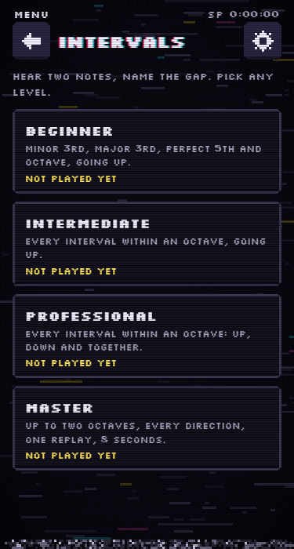

# Earcade

An 8-bit ear and theory trainer for your phone. Quick rounds of 10 questions: hear it, name it, and hear the right answer when you miss.

**Play it: [ethanmanco.github.io/earcade](https://ethanmanco.github.io/earcade/)**

<p align="center">
  
</p>

It feels like a daily practice game: four modes, four levels each, XP, a daily streak and a stats page. No accounts, no ads; progress stays on your device.

## Modes and levels

Every mode has four levels. Pick any level; after a strong round the game suggests the next one.

| Mode | Beginner | Intermediate | Professional | Master |
| --- | --- | --- | --- | --- |
| **Intervals**: hear two notes, name the interval | Minor 3rd, major 3rd, perfect 5th, octave. Going up. | Every interval within an octave. Going up. | Every interval within an octave: up, down and together. | Up to two octaves, every direction, one replay, 8 seconds. |
| **Chords**: hear a chord, name its quality | Major or minor. | Adds diminished, augmented, sus2 and sus4. | 7th chords: major 7, dominant 7, minor 7, minor 7 flat 5 (half diminished), diminished 7. | 7th chords in every inversion and in drop 2 voicings, plus dominant 9, major 9, minor 9, minor 11 and dominant 13 in close, open and shell voicings. One replay. |
| **Scale degrees**: hear a progression that sets the key, then a note; name its degree | 1, 3 and 5 in major keys. | All 7 degrees in major keys. | Major and minor keys, all 12 notes including chromatic ones. | A new key every question, two-note phrases (two picks, in order), the key plays only once. One replay of the notes. |
| **Fretboard**: a note name appears; tap where it is on the neck | Natural notes on the two lowest strings, frets 0 to 5. | Natural notes on all strings, frets 0 to 12. | Sharps and flats too, all strings, frets 0 to 12. | Every note on the whole neck to fret 15, 6 seconds each. |

Scale degrees sets the key with I IV V I (i iv V i in minor), and below Master a round stays in one key. Degrees are always named against the major scale (flat 3, flat 6, flat 7), so a name means the same sound in major and minor keys.

## How a round works

- 10 questions. Tap Play (or let it play itself), then pick an answer. Fretboard shows a note to find instead, and plays the note you tap.
- Right or wrong shows straight away, with a check or a cross and words, never color alone. A miss replays the right answer, and **Hear yours** plays what you picked, so you can compare the two.
- At the end: your score, how you did on each item (for example "perfect 5th: 2 of 3"), and what to practice.
- Items you miss come up more often in later rounds.

## Progress

- **XP:** 10 per right answer, times 1, 1.5, 2 or 3 from Beginner to Master, plus a bonus for a perfect round. XP adds up to player levels (level 2 at 100 XP, 3 at 300, 4 at 600, and so on).
- **Daily streak:** finish at least one round a day to keep it going. The home screen says when today's round is still to play.
- **Stats page:** accuracy for every mode and level, your last 10 rounds at each level as small bars (with the same scores as text), whether you're trending up or down, and your weakest items lately.
- Everything is saved in your browser. If storage is blocked (some private windows), the game still works; it just won't remember. Stats has a two-tap Reset progress button.

## Accessibility

- Every button has a spoken name ("minor 3rd", not "min 3"), and right or wrong is announced.
- Keyboard: 1 to 9 and 0 pick answers, R or Space plays or replays, Enter goes to the next question. On the fretboard, the arrow keys move along the neck and Enter taps.
- The fretboard is a grid a screen reader can walk ("A string, fret 3"). Spots never say their note until you answer, so the answer is not given away.
- Settings: piano or guitar, volume, reduced motion, auto-play on or off (so a screen reader and the notes don't talk over each other), and a Master time limit of normal, double or off.

## Built with

Vite, TypeScript and [Tone.js](https://tonejs.github.io/). The theory and question code is kept apart from the screen and tested on its own: every interval, chord and scale degree is checked in every key, every spot on the neck is checked under both spellings, every inversion and voicing is checked, and every level is checked to ask only what it should.

Parts come from my other projects:

- [Sixline](https://github.com/ethanmanco/sixline): music theory helpers, the guitar sound, the guitar samples and the accessible fretboard grid.
- [Pocket Pixels](https://github.com/ethanmanco/pocket-pixels): the 8-bit pixel style, chiptune game sounds, the safe saved-data pattern and the GIF recorder.

```bash
npm install
npm run dev
npm test
npm run demo -- http://localhost:5173/   # re-record docs/demo.gif (needs Chrome and the dev server)
```

It deploys to GitHub Pages from `main` with a GitHub Actions workflow that runs the tests first. It installs to a phone's home screen and works offline once loaded.

## Future ideas

Not in this version:

- Melody and rhythm dictation
- A daily shared challenge
- Leaderboards
- Accounts
- Microphone input (sing or play the answer)

## Sound and font licenses

- **Piano:** Salamander Grand Piano V3 by Alexander Holm, [Creative Commons Attribution 3.0](https://creativecommons.org/licenses/by/3.0/). 19 unmodified MP3 files from the [Tone.js audio repository](https://github.com/Tonejs/audio/tree/master/salamander); see [public/samples/piano/CREDITS.txt](public/samples/piano/CREDITS.txt).
- **Guitar:** steel-string acoustic guitar notes from the FluidR3_GM rendering in [midi-js-soundfonts](https://github.com/gleitz/midi-js-soundfonts) by Benjamin Gleitzman, [Creative Commons Attribution 3.0](https://creativecommons.org/licenses/by/3.0/). The original Fluid (R3) General MIDI SoundFont is Copyright (c) 2000-2002, 2008 Frank Wen, MIT License. See [public/samples/guitar/CREDITS.txt](public/samples/guitar/CREDITS.txt).
- **Game sounds:** synthesized in the browser; no audio files.
- **Music theory:** [tonal](https://github.com/tonaljs/tonal), MIT License.
- **Audio engine:** [Tone.js](https://github.com/Tonejs/Tone.js), MIT License.
- **Fonts:** Silkscreen and Press Start 2P, SIL Open Font License, via Fontsource.

Built with Claude Code. I designed, directed, reviewed, and tested it.
